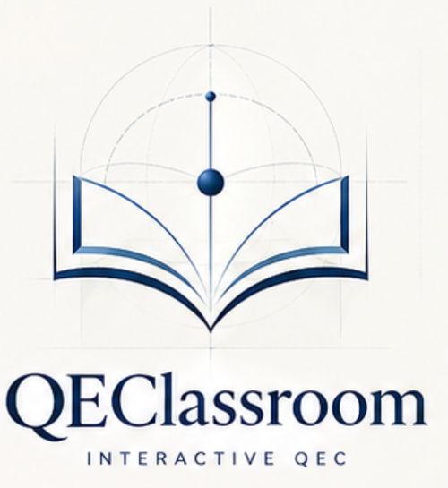
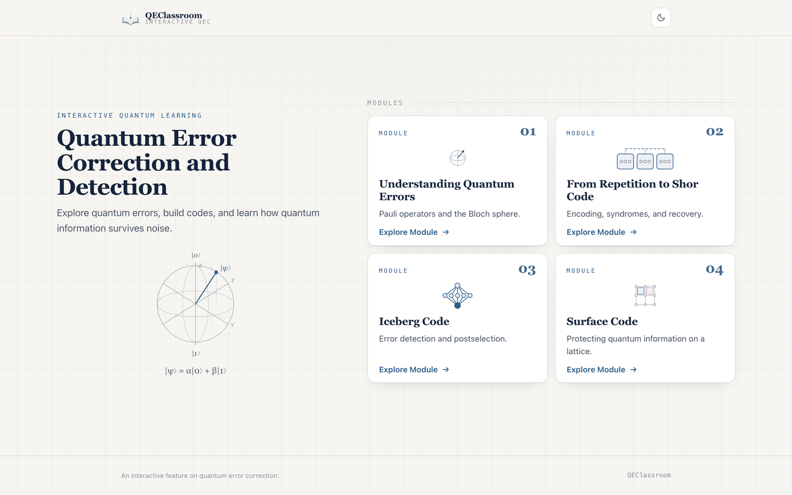
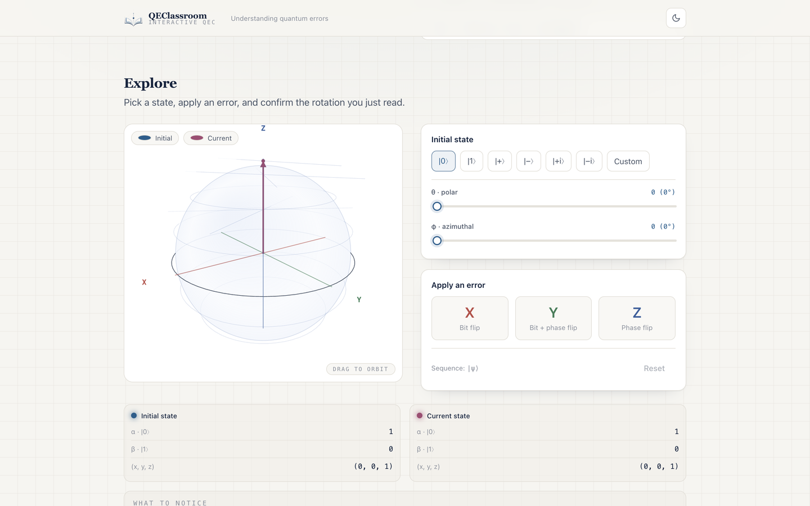
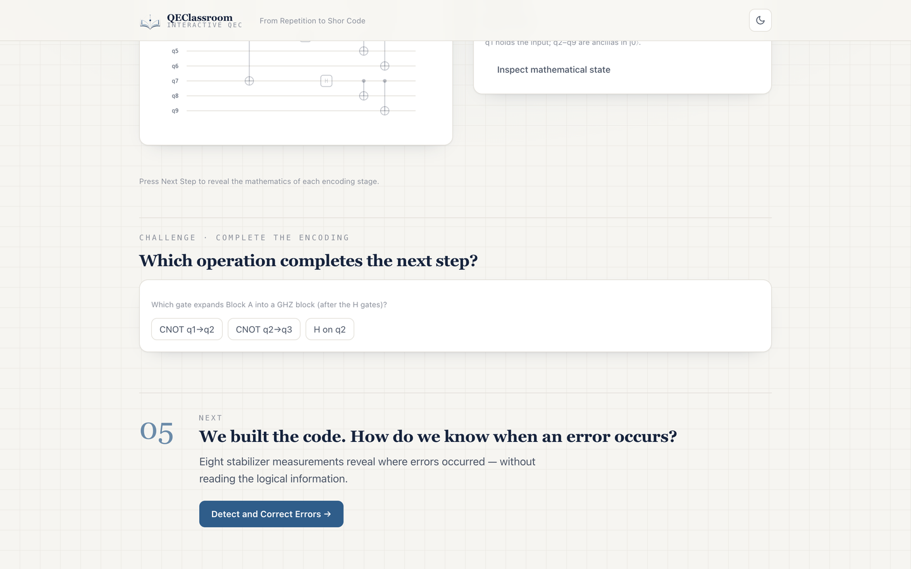
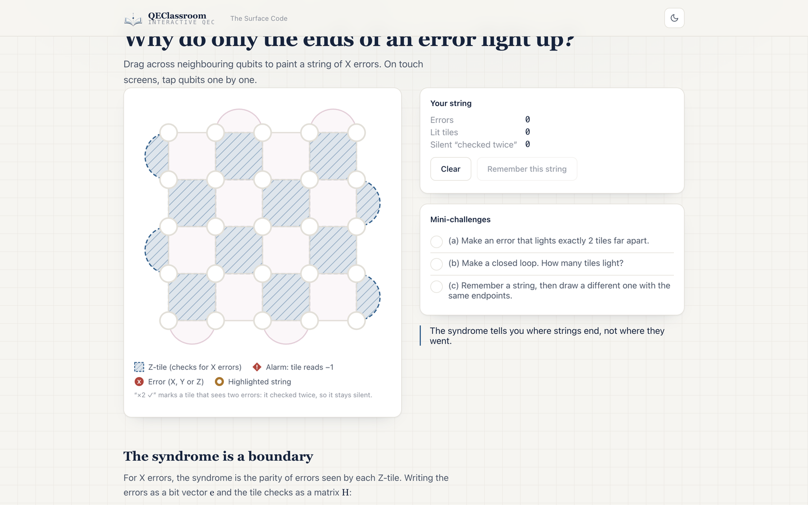
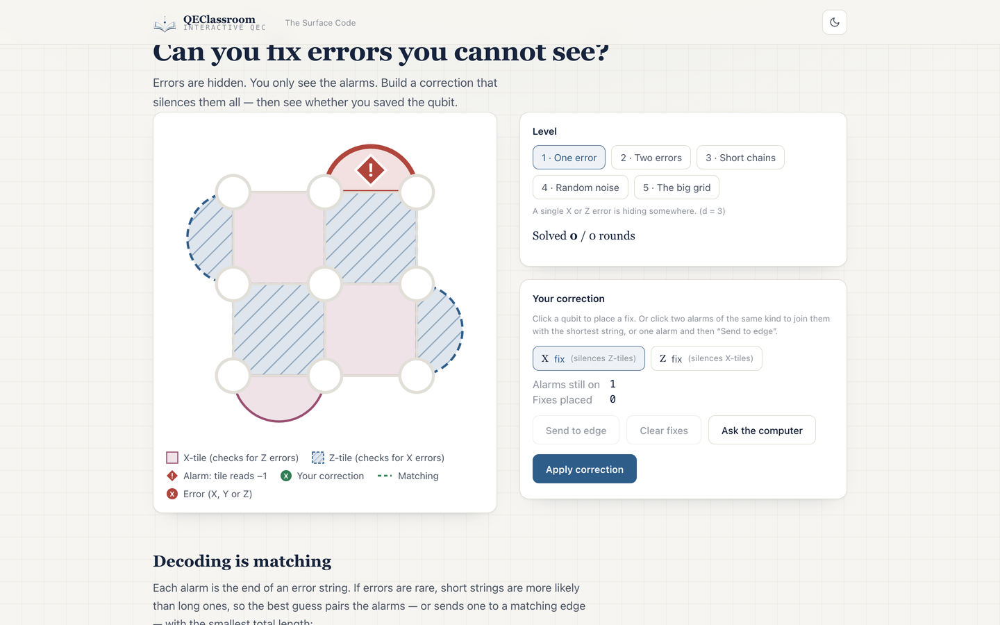
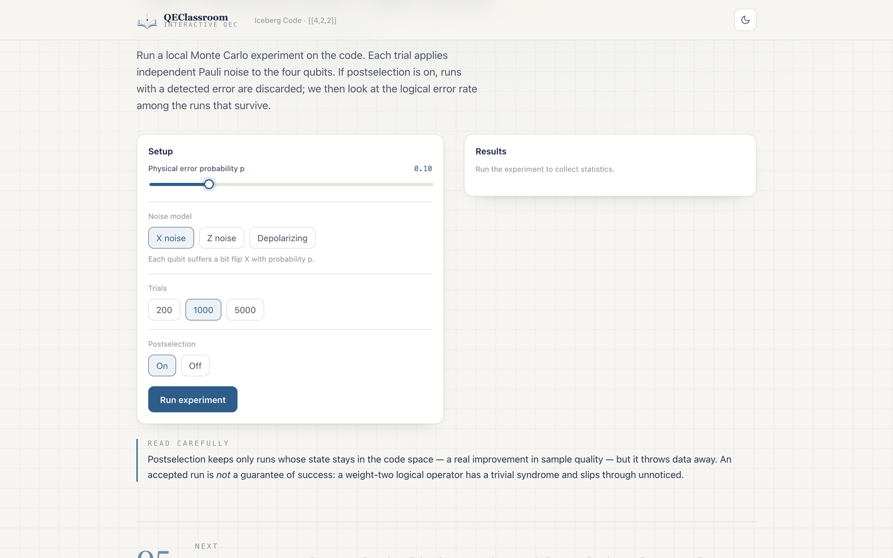

**This effort is supported by Qollab & IonQ**

<p align="center">
  
</p>

# QEClassroom

**Quantum Error Correction & Detection, Made Interactive.**

An interactive learning experience that turns quantum errors, stabilizers, and quantum codes into experiments you can explore, manipulate, and understand.

Built for the **Qollab × IonQ Hackathon — Quantum Unlocked**.

> **Live demo:** _placeholder — add the deployed URL here (GitHub Pages or the Qollab project link)._ Until then you can run it locally in one command (see [Getting started](#getting-started)).


*The home page: a scientific-editorial cover with an interactive Bloch-sphere motif and four module cards.*

## The Problem

Quantum error correction is one of the foundations of scalable quantum computing — and one of its hardest ideas to learn. Students must connect several layers at once:

- quantum states and transformations,
- physical errors,
- stabilizer measurements,
- logical encoding,
- error correction and detection,
- code distance and logical failures.

Each of these is readable on its own, but the intuition — *why* a set of local checks can protect a logical state, and *when* that protection breaks — is hard to build from equations and circuit diagrams alone.

**What if, instead of only reading about quantum error correction, you could experiment with it?**

## Meet QEClassroom

**A quantum error correction textbook you can interact with.**

QEClassroom combines scientific explanations with interactive visualizations, hands-on simulations, guided experiments, and quizzes. Every module follows the same rhythm:

**Understand → Experiment → Discover.**

The goal is to build genuine intuition **without giving up mathematical correctness**: every number on screen comes from an explicit quantum model, and the code that computes it is separate from the code that draws it.

## Four Modules. One Learning Journey.

### 01 — Understanding Quantum Errors

Start with a single qubit. See how the Pauli operators **X**, **Y**, and **Z** move a state on the Bloch sphere, why `{I, X, Y, Z}` is a complete basis for *any* single-qubit operator, and finish by identifying the hidden error behind an outcome.


*Module 1 — apply X, Y, or Z and watch the state vector move.*

### 02 — From Repetition to Shor Code

Build protection step by step: the three-qubit repetition code, error syndromes, bit-flip versus phase-flip protection, GHZ blocks, the nine-qubit Shor encoding, logical recovery, code distance, and a noise laboratory that compares code performance.


*Module 2 — construct and inspect the nine-qubit Shor encoding.*

### 03 — Iceberg Code `[[4,2,2]]`

Four physical qubits encode two logical qubits. Through stabilizer measurements you see how errors are *detected*, why their location can remain hidden, how postselection filters runs, and how an undetectable logical error can slip through.

![The [[4,2,2]] code](docs/assets/module-3-iceberg.png)
*Module 3 — detection without correction: syndromes and postselection.*

### 04 — Surface Code

Grow the repetition idea into two dimensions. Data qubits form a lattice with local stabilizer tiles (`X`-type and `Z`-type checks); errors appear as strings whose endpoints light up as syndromes. You decode the syndrome by matching, meet the logical operators and the code distance, and run a threshold experiment that shows when a bigger grid actually helps.


*Module 4 — a distance-5 surface code, its syndromes and its decoder.*

## Don't Just Read It. Experiment With It.

Three interactions carry most of the learning.

### Visualize quantum errors

Put a qubit on the Bloch sphere, apply Pauli operators, and watch the state move. Because the drawing interpolates the *real* Bloch vector of the updated state (not a scripted animation), what you see is what the linear algebra says.

*Learning outcome:* connect a matrix operation to a geometric rotation, and read the operator off the outcome.

### Become the decoder

Errors are hidden; only the syndrome is visible. Click qubits to build a correction, or let the computer match the alarms, then reveal whether the logical qubit was saved. The decoder pairs defects with the shortest connecting strings — and fails, correctly, when errors line up across the grid.


*Module 4 — decode a hidden error from its syndrome alone.*

### Discover the limits of protection

Inject multi-qubit errors, sweep noise, or run the postselection experiment. Some failures are reachable and can be fixed; others are invisible to every stabilizer. Seeing both is the point.


*Module 3 — when the syndrome looks trivial but the logical state is not safe.*

## Why QEClassroom?

**Progressive learning.** The platform walks one path: single-qubit errors → repetition code → Shor → Iceberg → Surface Code. Each module builds directly on the previous one.

**Learning by experimentation.** Users manipulate systems and observe the consequences, instead of only reading a description of them.

**Scientific integrity.** The platform is explicit about its distinctions:

- physical errors versus logical errors,
- error *detection* versus error *correction*,
- trivial syndromes versus harmless (stabilizer) operations,
- idealized noise models versus realistic hardware behavior.

Where a model is simplified, the interface says so.

## The Physics Behind the Classroom

**Pauli decomposition.** Any single-qubit error operator is a linear combination of the Pauli operators:

$$
E = aI + bX + cY + dZ, \qquad a,b,c,d \in \mathbb{C}.
$$

**Stabilizer syndromes.** A stabilizer measurement returns `+1` or `−1` according to whether an error commutes or anticommutes with the stabilizer. Because stabilizers commute with each other, they can be measured together without disturbing the encoded information.

**Shor code.**

$$
[[9,1,3]]
$$

Nine physical qubits, one logical qubit, distance three.

**Iceberg code.**

$$
[[4,2,2]]
$$

Four physical qubits, two logical qubits, distance two. It detects any single-qubit Pauli error but cannot guarantee correction of every single-qubit error: all four locations of the same error share one syndrome, so the location stays hidden.

**Surface code** with distance `d`:

$$
[[d^2, 1, d]], \qquad t = \left\lfloor \tfrac{d-1}{2} \right\rfloor .
$$

The lattice visualization follows the rotated surface-code geometry: a `d × d` patch of data qubits with `d² − 1` local checks, logical `X̄` along a column and `Z̄` along a row, meeting on the centre qubit.

*Honesty note:* unless stated otherwise, the simulations are **idealized**. The surface-code threshold experiment uses a **code-capacity** model (errors on data qubits, perfect stabilizer measurements); with exact matching its bit-flip threshold is close to 10%, while real hardware — where measurements also fail — sits nearer 1%. Nothing here runs on quantum hardware.

## Built With

The shipped platform is a **single vanilla HTML + CSS + JavaScript app** — no build step and no framework; the only external library is **three.js**, supplied by the Qollab runtime for the optional 3D sandbox. (`qollab-js/`)

- **UI & navigation.** A hash-router single-page app (`app.js`) with a shared editorial design system (`main.css`, `ui.js`).
- **Quantum simulation.** Pure, DOM-free JavaScript: complex numbers, matrices, states and Bloch vectors (`m1math.js`, `quantum.js`), Shor/repetition and noise models (`shor.js`, `noise.js`), the `[[4,2,2]]` engine (`iceberg.js`), and the surface-code Pauli-frame model with a matching decoder (`surface.js`, `decoder.js`, `game.js`).
- **Visualization.** Canvas-2D Bloch spheres (`bloch.js`), SVG lattices and circuits, and a small bar-chart renderer.
- **Quizzes & challenges.** A shared quiz state machine (`quizbase.js`) drives the Module 2, 3 and 4 knowledge checks (`quiz.js`, `icebergquiz.js`, `surfacequiz.js`) plus per-lesson challenges.
- **A three.js sandbox.** `errorslab/` adds a PhET-style "Systematic gate errors" lab with a 3D Bloch sphere (three.js is provided by the Qollab runtime).
- **Qollab packaging.** The app is laid out as a Qollab **JS project** (`index.html` + `main.js` + `main.css`; `README.md` becomes the project write-up). A separate **Python/Qiskit** circuit set lives in `qollab-js/quantum/` with a JavaScript runner (`circuits.js`).

## Getting Started

### Run it locally (one command)

```bash
./preview.sh          # serves the app at http://localhost:4123/
```

`qollab-js/index.html` is a Qollab project fragment (it has no `<script>`/`<link>`; the Qollab runtime injects `main.css` and runs `main.js`). `preview.sh` recreates that wiring locally and also maps `three` for the sandbox, so the app behaves exactly as it does on Qollab.

### Package it for Qollab

```bash
./make-zip.sh         # builds qollab-js.zip
```

Then, on Qollab: **New Project → Upload your own files**, drop `qollab-js.zip`, and press **Create**. The `README.md` inside the bundle becomes the project write-up.

### The Next.js prototype in this repository

The repository also contains an earlier **Next.js 16 + TypeScript** prototype of Module 1 (`src/`). It is kept for reference and is not needed to run the shipped app.

```bash
npm install
npm run dev           # Next.js dev server
npm test              # Vitest: 45 unit tests for the quantum math
npm run typecheck     # tsc --noEmit
```

## What's Next?

- **Wire the Python circuit runner** (`quantum/*.py` + `circuits.js`) into a "Run on Qollab" panel, so learners can execute the same codes against a chosen backend.
- **Richer noise models**, moving from code-capacity toward circuit-level noise and measurement errors.
- **More decoding experiments** (weighted matching, repetition over time, space-time decoding).
- **More codes and exercises** — additional stabilizer codes and further assessments.

These are directions, not shipped features.

## Team & Acknowledgments

**Team.**
- Alejandro Agudelo González
- Manuela Gómez Colorado
- José Luis Manco Velázquez
- Violeta Soto Martínez

**Hackathon.** Built for the **Qollab × IonQ Hackathon — Quantum Unlocked**.

**Built with open tools.** three.js (the 3D sandbox), Qiskit (the circuit set in `quantum/`), and the Qollab runtime. The Next.js prototype uses React, `@react-three/fiber`, KaTeX, and Vitest.

**Selected references.**

- M. A. Nielsen & I. L. Chuang, *Quantum Computation and Quantum Information* (Cambridge University Press).
- A. G. Fowler, M. Mariantoni, J. M. Martinis & A. N. Cleland, "Surface codes: Towards practical large-scale quantum computation", *Phys. Rev. A* **86**, 032324 (2012).
- Google Quantum AI, "Quantum error correction below the surface code threshold", *Nature* (2024) — the Willow result on operating below threshold.
- Qiskit documentation — gates, circuits, and the stabilizer formalism.
- Qollab documentation — projects, the runtime, and JS/Python integration.

*QEClassroom teaches well-known quantum error-correcting codes; it does not claim to have invented them.*
